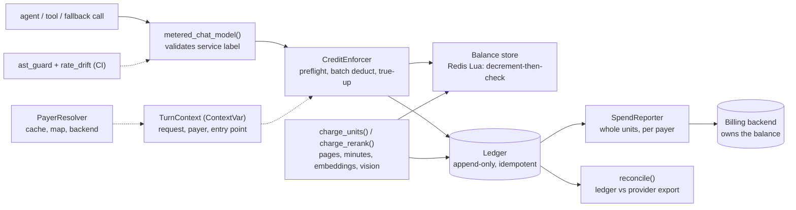

# llm-cost-meter

One cost and token meter for every paid AI call: streaming credit enforcement, an append-only ledger, and a spend reporter to a billing backend.

> An open-source reference implementation of unified LLM cost metering with streaming credit enforcement. All names and data are fictional.

[](https://github.com/Tayyab-Bilal/llm-cost-meter/actions/workflows/ci.yml)

Enforcement can be staged behind a flag (off, then meter, then enforce). This repo shows the whole path.

## The problem

A fictional "Acme Workspace" calls many paid providers: chat models, speech-to-text, document parsing,
embeddings, rerank. Nobody measured spend per customer, several vendors were never metered, and a wrong price
was undetectable, because every downstream number was derived from the same wrong number and so agreed with
every other. The product also needed a credit model: one balance, metered per use, refused
when empty.

Metering has traps beyond arithmetic. A model's answer streams, so you must deduct while it streams and cut
it off when credit runs out. Fallback chains can bill one request several times, and error callbacks carry no
usage, so reserve-then-refund is wrong. The customer's money already lives in a billing backend, so a second
balance in the AI service would be a second source of truth. And new code must not be able to call a provider
without being billed.

## What it does

- **Five separate meters** (`TOKEN`, `PAGE`, `AUDIO_MINUTE`, `EMBED_TOKEN`, `VISION_UNIT`) that are never
  converted into each other (`units.py`). Rerank is priced per search and filed under `EMBED_TOKEN`
  (`Meter.charge_rerank`); it has no meter of its own.
- **Integer micro-credits** everywhere; one `Decimal` rounding at the end (`units.py`, `pricing.py`).
- **Per-modality pricing**: cached input tokens, reasoning tokens (billed once, as output), and realtime voice
  priced separately for text and audio, each with a cached tier (`PriceTable.cost_realtime`).
- **Streaming enforcement** in three stages: pre-flight estimate, batched deduction as tokens arrive, signed
  true-up against provider-reported usage (`streaming.py`). Every tracked call streams internally, so plain
  `ainvoke` is enforced and cut off too, not only `astream`.
- **Cut-off contract**: running out cancels the stream and returns the partial answer with `truncated=True`
  (`ainvoke_metered`), or raises `CreditsExhausted` carrying the partial text (plain `ainvoke`).
- **Refusals are final**: `InsufficientCredits` can never be served by a fallback model (`streaming.py`).
- **Append-only, idempotent ledger** with Redis-style live balance (Lua: decrement-then-check, refuses a
  missing key, hash-tagged keys) (`ledger.py`, `balance.py`, `meter.py`).
- **Cost follows the entry point**: a `ContextVar` turn attributes every sub-agent, tool and fallback call to
  the user action that caused it, with no call-site changes (`context.py`).
- **Billing buckets** with a registry of service labels (`buckets.py`).
- **Payer resolution** through a TTL cache, a durable map and the backend, failing closed
  (`resolver.py`). All users of a tenant resolve to one shared organisation payer.
- **Spend reporter**: whole units per payer to a billing backend, carried remainders, forward-only positions,
  attempts recorded before sending, a per-payer claim so overlapping sweeps never double-report
  (`reporter.py`, `backend.py`).
- **Classified reconciliation** and balance drift detection (`reconcile.py`).
- **Rollout modes** `OFF`, `SHADOW`, `ENFORCE`.
- **Build-time guards**: an AST guard (provider client outside the factory, unregistered label, wrapper
  without a real base class) and a price-drift check against a pinned snapshot (`guards/`).
- **Credits API** (FastAPI): balance, usage, reconciliation, pricing history, with append-only price history
  (`api.py`, `pricing_history.py`).

## Quickstart

```bash
uv venv .venv && uv pip install -e ".[dev]"
.venv/bin/python examples/demo.py
.venv/bin/pytest -q
.venv/bin/python -m llm_cost_meter.guards.ast_guard src/
```

An excerpt of the demo's output (tenant B runs out of credit mid-answer; a retried document job bills once):

```text
2) Tenant B runs dry mid-answer: partial text, no error (delivered tokens settled).
   answer: 255 of 450 words, truncated=True
3) A document-parse job is retried after a worker crash: billed once.
   attempt 1: new_row=True
   attempt 2: new_row=False

request   payer    service    meter        kind     units    micro
req-A1    acme-a   chat       token        debit        7        7
req-A1    acme-a   chat       token        trueup       8       40
req-A1    acme-a   rerank     embed_token  debit       20    40000
req-B1    acme-b   chat       token        trueup      63      945
req-A2    acme-a   doc_parse  page         debit       12   120000
balance acme-a:    837688 micro-credits
balance acme-b:      -843 micro-credits

4) The backend owns the balance. Resolve the payer, then report whole units of spend to it.
   alice -> acme-a, bob -> acme-a (one shared payer)
   sweep 1 reported {'acme-a': 162, 'acme-b': 3}, carried 312 micro; sweep 2 reported {}
```

No real LLM or network is used anywhere: tests and the demo stream from a scripted fake chat model, and the
Redis Lua store runs on `fakeredis[lua]`.

## Usage guide

The shortest useful program: open a turn, call a tracked model, bill a non-token job. Every `python` block in
this README and in `docs/` is executed by `tests/test_docs.py`. The full guide is in
[docs/usage.md](docs/usage.md); the API is in [docs/api.md](docs/api.md).

```python
import asyncio
from decimal import Decimal as D

from llm_cost_meter import (
    Ledger, Meter, MeterKind, MeterMode, PriceTable, Rates, ainvoke_metered, metered_chat_model, turn,
)
from llm_cost_meter.balance import InMemoryBalanceStore
from llm_cost_meter.fakes import fake_llm_factory

prices = PriceTable({
    "acme-chat": Rates(input_per_mtok=D(3), output_per_mtok=D(15), cached_input_per_mtok=D("0.3")),
    "doc-parser": Rates(per_page=D("0.01")),
})
meter = Meter(Ledger(), InMemoryBalanceStore(), prices, MeterMode.ENFORCE)
meter.topup("acme-a", 1_000_000, key="purchase-1")


async def main() -> None:
    with turn(tenant="acme", payer="acme-a", entry_service="chat", request_id="req-1"):
        llm = metered_chat_model("chat", "acme-chat", llm_factory=fake_llm_factory("plan the sprint now"), meter=meter)
        result = await ainvoke_metered(llm, [("user", "plan the sprint")])  # result.truncated if credit ran out
        print(result.text, "| truncated:", result.truncated)
        meter.charge_units(MeterKind.PAGE, 12, work_key="doc-1", service="doc_parse", model="doc-parser")


asyncio.run(main())
print("balance:", meter.balances.get("acme-a"), "micro-credits")
```

## How it works



The main flow, for one chat call:

1. The entry point opens a `turn` (tenant, payer, entry service). The payer comes from `PayerResolver`.
2. `metered_chat_model` builds the model through your factory and attaches one `CreditEnforcer`. Because the
   enforcer declares itself a streaming handler, LangChain streams even a plain `ainvoke` internally.
3. **Pre-flight**: the enforcer estimates input tokens and deducts them. If the payer cannot cover it, it
   raises `InsufficientCredits` before any token exists.
4. **While streaming**: output is deducted in batches. A refused batch raises `CreditsExhausted`, which
   cancels the stream (and the provider stops billing). The caller gets the partial text.
5. **True-up**: at the end, a signed correction replaces the estimates with the provider's reported usage
   (cached and reasoning tokens included). On a cancel or provider error, what the user actually received is
   settled instead.
6. Each deduction is a ledger row under an idempotency key; the live balance is a cache of the ledger.
7. On a schedule, `SpendReporter.sweep` sends whole credits per payer to the billing backend and carries the
   remainder. Per-unit work (`charge_units`) follows steps 5 to 7 without the streaming.

## Design decisions

1. **One choke point.** Every model goes through `metered_chat_model()`, and enforcement attaches there. Move
   every call site onto it and attach enforcement in that one place. *Rejected:* decorating each call site (one forgotten site is an
   unbilled feature).
2. **Separate, non-convertible meters.** Tokens and document pages are different units with different
   economics. *Rejected:* one "credit per call" meter, which hides what a call actually cost.
3. **Integer micro-credits.** No floats in money; rounding once, half up. *Rejected:* float or per-step
   rounding, which drifts.
4. **The ledger is the source of truth; the live balance is a cache.** A row is written at most once per
   idempotency key; non-token charges key on the work, so a retried job bills once. Everything except a debit
   is ledger-first (row, then balance, guarded by an `applied` flag so a retry finishes the job). A debit is
   balance-first with compensation (decrement-then-check, then the row; the decrement is given back if the
   insert fails), because the check must be atomic. `rebuild_balance()` and `balance_drift()` repair and
   detect cache drift. Purchases are ledger rows too. The cache never invents a balance for a missing key, so
   a refund cannot mint credit.
5. **No reservations: deduct while streaming, then true up.** Fallback chains can bill one request up to
   several times and error callbacks receive no usage. *Rejected:* reserve-then-release.
6. **Running out cancels the stream** and returns the partial answer, not an error. Delivered work is billed
   on cancel or provider failure (overdraft bounded by one batch). *Rejected:* an error on exhaustion, which
   throws away an answer the user can already read.
7. **Every call streams internally.** Cut-off needs a stream, so the tracked model streams even under plain
   `ainvoke`. This relies on a LangChain internal (the handler duck-types its private streaming protocol);
   a test pins it. *Rejected:* "use `ainvoke_metered` or be unenforced".
8. **A refusal is final.** `InsufficientCredits` derives from `BaseException` so no fallback chain catches
   it. A mid-stream cut-off is an `Exception` (LangChain's batch code mishandles other kinds raised mid-stream),
   but a fallback that starts afterwards is refused at pre-flight for the same payer.
9. **Cost follows the entry point.** Identity comes from the turn, read at call time, never cached on a
   long-lived object. *Rejected:* passing a payer into every call, and module-level identity (one tenant
   paid for another). A missing or `"system"` tenant raises instead of being billed to a catch-all.
10. **The backend owns the balance; the AI service owns the meter.** A second balance would be a second source
    of truth for one customer's money. Payers resolve through cache, durable map, then backend, and fail
    closed. A tenant's users share one organisation payer, so per-user keying would have granted a 25-user
    tenant 25 times its balance.
11. **Report whole units, carry the remainder, move forward only.** The attempt is recorded before the send;
    a failed send is retried with the same operation id; a claim per payer stops overlapping sweeps.
    *Rejected:* advancing the position before the send (a failure would lose spend).
12. **Build-time guard.** CI fails on a provider client outside the factory, an unregistered label, a
    look-alike wrapper with no real base class, and price-table drift from a pinned snapshot. It is a
    deny-list, not a proof; see Limits.
13. **Measure, then meter (shadow), then enforce.** Rollout modes `OFF`, `SHADOW`, `ENFORCE`.
14. **When forced to choose, undercharge.** Where a rule has to pick a failure direction, the design errs
    toward undercharging, never overcharging: for example, a provider failure before any token credits the
    estimate back, and a refund never creates a balance that was not there.

## Testing

```bash
.venv/bin/pytest -q                                   # a few seconds, no network
.venv/bin/ruff check src tests examples
.venv/bin/python -m llm_cost_meter.guards.ast_guard src/ tests/test_*.py tests/conftest.py
```

| Invariant | Test |
|---|---|
| Money is integer micro-credits; floats rejected | `test_money_is_integer_micro_credits`, `test_float_units_are_rejected` |
| Lua refuses a missing key and never overdraws | `test_redis_lua_refuses_missing_key`, `test_redis_lua_no_overdraw_under_concurrency` |
| Ledger is idempotent; a retried job bills once | `test_ledger_idempotent_on_key`, `test_retried_ingestion_bills_once` |
| Ledger total equals balance under load | `test_soak_ledger_matches_balance` |
| A refund cannot mint credit | `test_adjust_refuses_missing_balance_in_both_stores`, `test_refund_cannot_mint_credit_when_the_deduct_path_degraded` |
| Stream deducts in batches and cuts off with a partial answer | `test_stream_deducts_in_batches`, `test_stream_cancelled_when_credits_run_out_returns_partial` |
| Every call streams internally | `test_plain_ainvoke_streams_internally_and_is_metered_in_batches`, `test_plain_ainvoke_is_cut_off_when_credit_runs_out` |
| A refusal is never served by a fallback | `test_refusal_is_final_and_never_served_by_a_fallback_model`, `test_cutoff_mid_stream_is_not_continued_by_a_fallback_model` |
| A failed primary is billed once | `test_provider_failure_is_billed_once_and_the_fallback_is_billed_for_its_own_call` |
| Identity comes from the turn, not a singleton | `test_singleton_llm_bills_each_turns_own_payer_never_the_first_caller` |
| A missing or "system" tenant fails closed | `test_turn_requires_a_real_tenant_and_payer`, `test_missing_or_system_tenant_is_refused_before_any_lookup` |
| Sub-agent cost lands on the entry point; survives `gather` | `test_subagent_cost_attributed_to_entry_point`, `test_attribution_survives_gather_and_create_task` |
| Realtime is priced per modality | `test_realtime_is_not_billed_entirely_at_the_audio_rate`, `test_realtime_cached_tier_is_separate_per_modality` |
| Reasoning tokens bill once | `test_reasoning_tokens_are_billed_once_as_output_tokens` |
| Meter set; rerank per search | `test_meter_set_matches_the_five_documented_meters`, `test_rerank_is_priced_per_search_under_the_embed_meter` |
| Payer resolution fails closed; shared org payer | `test_fails_closed_when_authority_is_down_and_nothing_is_cached`, `test_all_users_of_a_tenant_resolve_to_one_shared_organisation_payer` |
| Reporter: whole units, remainder, forward-only | `test_reports_whole_units_and_carries_the_remainder`, `test_positions_only_move_forward_and_a_clean_sweep_is_a_noop` |
| Reporter: record before send; failure retried once | `test_attempt_is_recorded_before_the_send`, `test_failing_sender_keeps_the_position_and_retry_reports_once` |
| Overlapping sweeps never double-report | `test_two_concurrent_sweeps_never_report_the_same_spend_twice` |
| Guard: bypass, unbucketed label, wrapper without base | `test_ast_guard_catches_bypass`, `test_wrapper_without_a_real_base_class_is_flagged` |
| Guard: rate drift | `test_a_changed_rate_is_reported_as_drift`, `test_current_rates_match_the_pinned_snapshot` |
| Credits API scoped to the caller | `test_usage_is_scoped_to_the_callers_own_payer`, `test_identity_is_required` |
| Docs examples run | `test_python_blocks_in_docs_run` |

## Limits & known trade-offs

- The ledger is one SQLite connection behind a lock. A streamed chunk counts as one token for batching; the
  true-up uses the provider's usage report (a warning is logged if none arrives).
- A debit decrements the cache first, then inserts the row. If the insert fails, the decrement is given back.
  Only a crash between the two steps leaves the cache lower than the ledger; `balance_drift()` detects it and
  `rebuild_balance()` repairs it. `rebuild_balance()` should run with that payer quiet.
- On a cancel, the overdraft is bounded by one batch, so a balance can go slightly negative. A fallback that
  starts after a mid-stream cut-off is refused only if the payer's balance cannot cover its pre-flight.
- The streaming-everywhere behaviour depends on a LangChain internal protocol; a test fails if it changes.
- The Redis store uses the sync client. The turn `ContextVar` follows `await`, `gather`, `create_task` and
  `asyncio.to_thread`, but not a bare `run_in_executor` or plain thread (wrap with `copy_context().run`).
- The AST guard is a deny-list of known clients, not a proof: it cannot see `getattr` with a variable name,
  `vars()` lookups, vendors not on the list, or an alias of `charge_units`. The wrapper check is a heuristic
  (a base-less class that defines a known interface method). `charge_units` with an unknown label raises
  while enforcing.
- The payer cache is per process, and `payer_map` rows are never refreshed once written; a real deployment needs
  an invalidation story for a payer that changes.
- The reporter's remainder can go negative after a net credit-back; it is carried, never reported as a
  negative unit. Pending attempts are retried one at a time per payer.
- The credits API reads the payer from a header as a stand-in for token-derived identity; the operator routes
  need your own protection.
- LangChain logs a warning whenever a callback raises; the cancel signal is expected, so the demo silences it.

Dependencies: `langchain-core`, `redis`, and `fastapi` (for the credits API). The `dev` extra adds `pytest`,
`pytest-asyncio`, `fakeredis[lua]`, `httpx` (FastAPI's test client) and `ruff` (lint only).

## Project layout

```text
src/llm_cost_meter/
  units.py            MeterKind, micro-credit helpers
  pricing.py          Rates, PriceTable (tokens, units, rerank, realtime per modality)
  pricing_history.py  append-only price changes
  ledger.py           append-only SQLite ledger, idempotent rows
  balance.py          in-memory and Redis (Lua) live balance
  context.py          TurnContext in a ContextVar, task headers, identity checks
  buckets.py          service label to billing bucket
  meter.py            Meter: debit, true-up, top-up, charge_units, charge_rerank, rebuild
  streaming.py        CreditEnforcer: preflight, batched deduction, cut-off, true-up
  factory.py          metered_chat_model, ainvoke_metered
  resolver.py         PayerResolver (cache, map, authority; fail closed)
  reporter.py         SpendReporter (whole units, carried remainder, claims)
  backend.py          FakeBillingBackend (authority and spend receiver)
  reconcile.py        classified reconciliation, balance drift
  api.py              FastAPI credits router
  fakes.py            scripted fake chat model
  guards/ast_guard.py     build-time AST guard
  guards/rate_drift.py    price drift check
examples/demo.py      end-to-end walkthrough; examples/bad_service.py is what the guard rejects
docs/usage.md, docs/api.md
tests/                invariants, regressions, docs examples; tests/fixtures/ feed the guards
```
